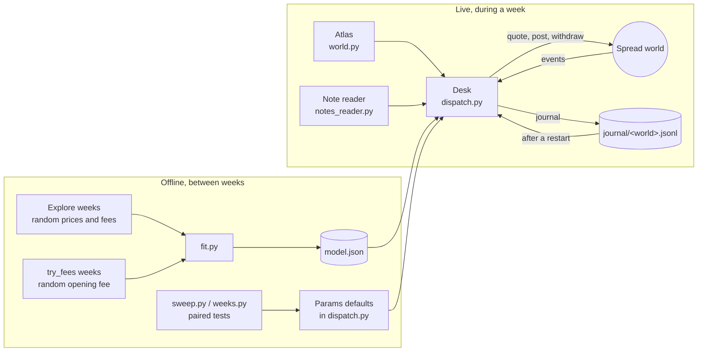
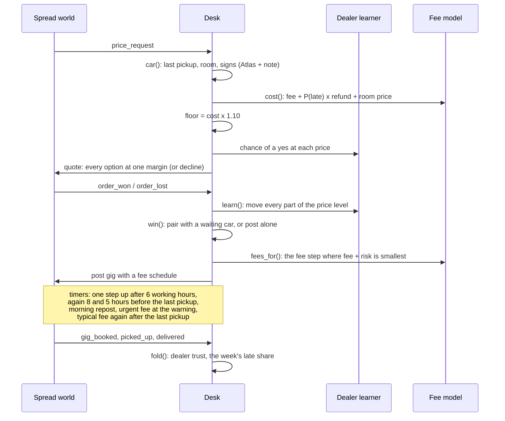
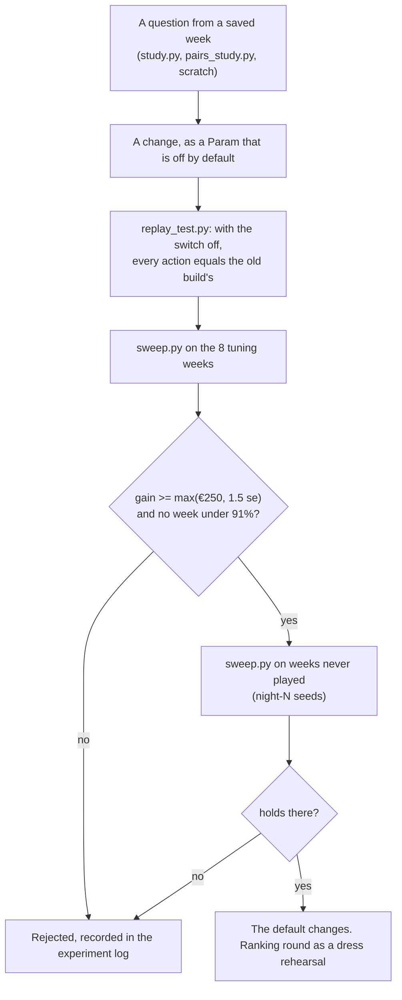

# Architecture

How the dispatch desk is built: the parts, what each one decides, and how a week flows through them.
The README says what the desk earns; this file says how it works.

## 1. The parts

| Part | File | What it holds | What it decides |
|---|---|---|---|
| Desk | `dispatch.py` (`Desk`, about 800 lines) | Orders, gigs, fee schedules, beliefs about dealers, timers | Every quote, every gig, every fee |
| Atlas | `world.py` (`Atlas`) | Roads, driving times, opening hours, where drivers live | Nothing: it answers questions (when is the last pickup, how many drivers are near) |
| Note reader | `notes_reader.py` | Rules for dealer notes (MIT licence) | Nothing: it turns a note into ready time, deadline, plates, manual licence |
| Model | `model.json` (made by `fit.py`) | Weights of the on-time model, the fee-paid model, the dealers' curve | Nothing: the desk reads it |
| Params | `Params` in `dispatch.py` | Every number the desk uses, each with the measurement that chose it | Nothing: each is a switch or a constant |
| Kit starter | `spread/starter.py` | The event loop, orders, legs, gigs, retries, restart | The desk inherits from its `Desk` and overrides the decisions |

## 2. One request, from arrival to delivery

### 2.1 Quote (`Desk.quote`)

For each option the car can make:

1. `car()` asks the Atlas and the note for the last minute a driver can collect the car and still arrive in time. No such minute: the option is not offered.
2. `cost()` returns, in cents:

   $$c = \text{typical fee} \times \mathbb{E}[\text{fee multiple paid}] + P(\text{late})\cdot \text{refund} + \text{room used}\cdot\lambda$$

   - `fee()` picks the fee step $f$ that minimises fee plus risk; $P(\text{late})$ is read at that fee.
   - refund: 0.47 × list price, measured, plus the dealer's trust that a late car destroys (`trust_at_stake`).
   - room used: $P(\text{late}) - 4\%$. Negative for a safe car, so it gives room back.
   - $\lambda$ (`late_price`): the price of one late order, from `look()`.
3. Floor: $c \times (1 + 0.10)$ (`reserve`).
4. For each multiple of list price from 0.60 to 3.00: expected gain = (price − floor) × P(yes). The best option and multiple win.
5. The menu: every option goes out at the same margin above its own floor, so the dealer chooses the speed.
6. Declined: the best expected gain is not positive, or the lane is full (`lane_full`: 8 of our cars already wait on the same lane of 200 km or more). A decline is a quote at 4 × list, which never wins.

### 2.2 Dealer learner (`parts`, `level_of`, `chance`, `learn`)

The dealer says yes half the time at a price level. Its log is a sum of parts, each with a mean and a variance:

| Part | Prior | Spread |
|---|---|---|
| the week | log 1.33 | 0.06 |
| the day | 0 | 0.15 |
| the dealer | 0 | 0.02 |
| the delivery town | from `model.json` | 0.03 |
| the pickup town | from `model.json` | 0.01 |
| the pickup town on that day | 0 | 0.04 |
| the lane | 0 | 0.05 |
| the dealer's trust | +0.95% per order delivered on time, up to 25 | fixed |

$$P(\text{yes}\mid p) = \sigma\!\left(\frac{s\,(\mu - \log p')}{\sqrt{1 + \pi s^2 \sigma^2_\mu / 8}}\right), \qquad s = 12$$

- $\mu$, $\sigma^2_\mu$: the sum of the parts' means and variances
- $p'$: the price as the dealer weighs it, the slower options' euro gaps added (€15 for next day, €8 more for within three days)

Each answer is one Kalman-style step on every part it touched (`learn`): a yes moves them up, a no down, each by its share of the variance. The variance shrinks as answers come.

Outage days: `down_chance` keeps, for each town and working day, the chance that the competitor is down there. Each answer moves that chance by Bayes' rule (`learn`): a yes at a price the usual curve rarely accepts makes an outage likely. Where it is likely, the quote also weighs the dealer's curve without the competitor (`alone`).

### 2.3 Gig and fees (`win`, `pair`, `post`, `fees_for`)

- **Pair or alone.** `pair()` looks for a waiting car that a driver can take with the new one: the second car starts within 30 km of where the first ends, the planned drive is under 5 hours, and neither car is collected before it is ready (`chain`). Not on Fridays. A pair pays 0.75 × the two typical fees (0.9 × for small gigs). With no driver after 45 minutes, the cars go alone (`split`).
- **The opening fee.** `fee()` over the grid 0.70 / 0.85 / 1.00 / 1.15 / 1.30 / 1.50 × typical:

  $$f^{*} = \arg\min_{f}\; \text{typical} \times \text{paid}(f) + \big(1 - P_{\text{on time}}(f)\big)\cdot L$$

  $L$ = refund + trust at stake + $\min(\lambda, €150)$ (`calm_eur`).
- **The schedule.** One step up after 6 working hours without a driver (`look_h`), and again 8 and 5 working hours before the last pickup (`marks`). Each step is a new gig (`fresh`): the app tells nearby drivers of a new gig, never of a new fee.
- **Warnings and late cars.** At the deadline warning: 1.6 × typical (`urgent_fee`). Once the last pickup has passed with no driver: back to 1.0 × typical, one step up every 4 working hours (`late_fee`). In the world's last 36 hours, any car still late goes at 2.5 × (`last_fee`), because an undelivered car costs twice its price.
- **Mornings.** At 08:05 on each working day, gigs left from an earlier day are posted again (`morning`, `again`).
- **Rescue.** A car whose post the world refused gets a gig without windows (`rescue`).

### 2.4 The week's view (`look`)

Once a minute the desk compares what the model said of each order when it was posted with what has happened since:

1. `world_shift`: one number, fitted by four Newton steps, that moves every on-time forecast towards this week's drivers.
2. The expected number of late orders this week: those already late, plus each waiting car's chance of being late.
3. $\lambda$ = €300 × $u^4$, where $u$ = expected late orders ÷ (4% of the orders won, plus 20 orders of prior). $u$ is capped at 2, so $\lambda$ runs from about €0 to €4,800. Near zero while the week is safe, steep near the limit. (In the Sunday 03:00 round, week 4, it reached €4,800 on Thursday: the desk then declined most requests. See the README's limits.)

## 3. State and restart

| State | Where it lives | After a restart |
|---|---|---|
| Orders, gigs, legs | the world | read back from the world's snapshot and history (kit starter) |
| Beliefs about dealers | the desk's memory | rebuilt by replaying every answer of the week against the quotes in the journal |
| Quotes sent | `journal/<world>.jsonl` | read from the journal |
| Forecast of each order at its post | `journal/<world>.jsonl` | read from the journal |
| Fee schedules | the world's gigs | read back from each gig (`carry`) |
| Timers | the desk's memory | rebuilt from the schedules and the clock |

`final.sh` restarts the desk three seconds after it stops. In a test final with a stop on purpose, the rebuilt desk held the same orders, fees and beliefs, and missed none of 1,030 requests.

## 4. Offline loop: how a change gets in

The [experiment log](../research/EXPERIMENT_LOG.md) records the results and decisions.

- **Paired weeks.** A seed gives the same week to the euro, so a difference on the same seeds is the change itself. `weeks.py` lists which weeks a change moved and by how much.
- **Explore weeks** (`explore=true`): random prices 1.0 to 1.9 × list and random fees. They lose money on purpose; they are the data for the dealers' curve.
- **try_fees weeks**: the desk plays as usual, but each gig opens at a random fee of the grid. They are the data for the on-time model and the fee-paid model.
- `fit.py` fits both and writes `model.json`. The desk reads it at start.

## 5. Files

| File | Role |
|---|---|
| `dispatch.py` | The desk, its `Params`, and `main()` (practice weeks, ranking runs, the final) |
| `world.py` | `Atlas`: map, hours, drivers; `signs()` for the on-time model; `with_fee()` |
| `fit.py` | Fits `model.json` from saved weeks |
| `model.json` | The fitted models |
| `notes_reader.py` | Dealer-note reader, used unchanged under its [MIT licence](../../engine/notes_reader.py). Our pairing experiments tested the readiness check that uses its output. |
| `sweep.py` | Many configurations on many seeds, 8 weeks at a time; `--summary` for paired tables |
| `weeks.py` | Week-by-week comparison of two configurations |
| `night.py`, `tonight.sh` | An unattended night of paired tests |
| `final.sh` | The final with a restart loop; loads the team key from `.env` |
| `check_final.py` | Which requests of the final were answered in time |
| `replay_test.py`, `restart_test.py` | A saved week replayed through a new build; a desk rebuilt after a restart |
| `board.py`, `clean.py` | The ranking table; freeing practice slots |
| `study.py`, `pairs_study.py`, `cv.py`, `analyze.py`, `v4_look.py`, `slim.py` | Analyses of saved weeks |
| `dispatch_v1.py` to `dispatch_v3x.py` | Earlier versions, kept for the record |
